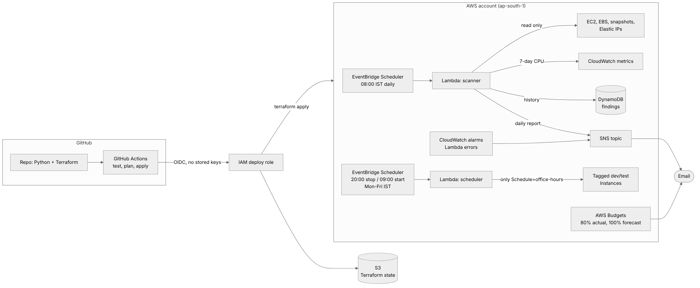

# AWS Cost Watchdog

A small serverless tool that finds AWS resources you're paying for but not using, emails you a daily
report with a dollar figure on each one, and switches dev/test servers off outside office hours.

Everything is defined in Terraform and deployed by GitHub Actions through OIDC, so no AWS keys are
stored anywhere.



## The problem

Most cloud waste is boring. Someone launches a test server for a demo and forgets it. An instance gets
terminated but its disk doesn't. A snapshot taken "just before the upgrade" sits there for two years.
An Elastic IP stays allocated after the server it pointed at is gone. None of these break anything, so
nobody notices. They just show up on the bill.

Dev and test servers have a second problem: they run 168 hours a week for people who work about 55.
Stopping them from 20:00 to 09:00 and over weekends cuts their compute bill by roughly two thirds.

## What it does

**A daily scan** (Lambda, 08:00 IST) checks every configured region for:

| Check | Flagged when |
|---|---|
| Idle EC2 instances | Average CPU under 5% for 7 days **and** never above 30% |
| Long-stopped instances | Stopped for 14+ days (compute is free, but the disks still bill) |
| Unattached EBS volumes | Volume isn't attached to any instance |
| Old snapshots | Older than 90 days and not used by any AMI |
| Unused Elastic IPs | Not associated with anything |

Each finding gets an estimated monthly cost, is saved to DynamoDB (so the report can say when it was
first flagged), and goes into one email through SNS.

**An office-hours scheduler** (Lambda, 20:00 and 09:00 IST, Mon to Fri) stops and starts instances
tagged `Schedule=office-hours`. Nothing else gets touched.

Here's what the email looks like (from `python scripts/demo_report.py`, which runs the real scanner code
against a fake AWS account):

```
Subject: AWS cost watchdog: ~$125.89/month of waste in 7 resources

Found 7 resources costing about $125.89 a month ($1,510.68 a year).

IDLE EC2 INSTANCES  ($98.11/month)
  - i-be09b8dad88c84415 (old-jenkins), ap-south-1
    avg CPU 2.3%, peak 3.1% over 7 days. Costs about $65.41/month.
  - i-cb917dfd492eb445d (staging-api), ap-south-1
    avg CPU 1.3%, peak 2.1% over 7 days. Costs about $32.70/month.

EBS VOLUMES NOT ATTACHED TO ANYTHING  ($13.22/month)
  - vol-79593867ea509eabe, ap-south-1
    100 GB gp2, unattached, created 120 days ago. Costs about $11.40/month.
...
Nothing was stopped or deleted. This is a report only.
```

Full sample: [docs/sample_report.txt](docs/sample_report.txt). The demo account also has a busy
production server and a nightly batch job server. Neither shows up in the report, which is the point.

## Decisions I made, and why

**Report, don't delete.** The scanner has no permission to change anything. A tool that deletes an
"unused" volume that turns out to hold the only copy of someone's data does more damage in one morning
than it saves in a year. Deleting stays a human decision.

**Peak CPU as well as average.** A server that idles all day but runs a batch job at 2 AM has a low
average and is still doing real work. Requiring the peak to stay under 30% keeps those off the list.

**Opt-in scheduling, enforced by IAM.** The scheduler only acts on instances with the tag, and the IAM
policy has a condition on that same tag. Even if the code had a bug and passed a production instance ID,
AWS would refuse the stop call.

**History in DynamoDB.** "This volume is unattached" gets ignored. "This volume has been unattached since
3 February" gets acted on. One row per resource per day, deleted automatically after 90 days with TTL.

**Fail loudly, but only once.** If a check fails (say, a missing permission), the email still goes out
with the other results and a list of what failed, and then the Lambda raises an error so the CloudWatch
alarm fires. Lambda retries async calls twice by default, which would have meant three identical emails,
so retries are switched off for the scanner.

**No stored AWS keys.** GitHub Actions gets short-lived credentials through OIDC. The deploy role only
trusts the `main` branch of this repo and can only manage resources whose names start with `cost-watchdog-`.

**Small things that cost nothing.** Lambda log groups are created by Terraform with 14-day retention
(left to Lambda, they keep logs forever, which is exactly the kind of quiet cost this project hunts).
The functions run on arm64, which is cheaper per second than x86.

## Testing

- **32 unit tests** with [moto](https://github.com/getmoto/moto), which fakes AWS in memory. They cover
  every check, including the cases that should *not* be flagged (busy servers, batch jobs, new instances,
  snapshots behind an AMI), the full scan-save-email flow, and the scheduler's tag filtering and dry-run mode.
- **Terraform** passes `fmt` and `validate` against the real AWS provider schema. I also applied the whole stack against a local moto server:
  21 of 22 resources created cleanly. The exception is the AWS Budget, which moto can't fully emulate.
- CI runs all of this on every push.

```bash
pip install -r requirements-dev.txt
pytest -v
python scripts/demo_report.py
```

## What it costs to run

Very little. One scan and two scheduler calls a day sit well inside Lambda's free monthly allowance.
DynamoDB on-demand for a few dozen writes a day, SNS email, EventBridge Scheduler and two CloudWatch
alarms are all free or close to it at this volume. I expect a few cents a month, mostly for the S3 state
bucket and logs. The AWS Budget alert in the stack will tell you if I'm wrong.

## Deploying it

Step by step, from a fresh AWS account to the first email: [docs/deploy.md](docs/deploy.md).

The short version:

1. `terraform/bootstrap`: run once by hand. Creates the state bucket and the GitHub OIDC deploy role.
2. Add the role ARN, bucket name and your email to the repo's Actions settings.
3. Run the **Deploy** workflow.
4. Confirm the SNS subscription email.
5. Optional: `scripts/create_test_waste.sh` creates a little deliberate waste to watch it get caught.

## Repo layout

```
├── src/
│   ├── handlers.py            Lambda entry points
│   └── watchdog/
│       ├── checks.py          the five waste checks (read-only)
│       ├── scanner.py         runs checks, saves history, sends the email
│       ├── scheduler.py       stops/starts tagged instances
│       ├── report.py          builds the email text
│       ├── pricing.py         approximate ap-south-1 prices
│       └── config.py          settings from environment variables
├── tests/                     pytest + moto
├── terraform/                 main stack (Lambda, IAM, Scheduler, DynamoDB, SNS, alarms, budget)
│   └── bootstrap/             state bucket + GitHub OIDC role, applied once by hand
├── .github/workflows/         CI on every push, deploy on main
├── scripts/                   demo report, create/clean up test waste
└── docs/                      deploy guide, architecture source, sample report
```

## Limits, and what I'd add next

- **Prices are a hard-coded table** for ap-south-1 and will drift. The next step is the AWS Pricing API,
  cached daily.
- **CPU alone doesn't prove idleness.** A server can sit at 1% CPU and still be serving a few important
  requests a day. Adding network traffic to the check would cut false positives.
- **More resource types:** idle RDS instances, NAT gateways with no traffic, load balancers with no targets.
- **One account at a time.** For a company with many accounts, this would run from a central account and
  assume a read-only role in each member account through AWS Organizations.
- **Slack instead of email** for teams that live there.
- Starting instances with EBS volumes encrypted by a customer-managed KMS key needs `kms:CreateGrant` on
  that key, which the scheduler role doesn't have yet.
